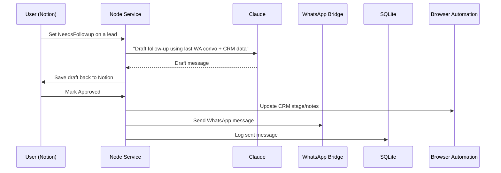

# Full System Overview

This document provides a visual, non-technical explanation of the complete
automation system you’ve been building. It covers the components, the data
flow, and how the pieces connect. Diagrams are included for clarity.

---

## 🧱 System Components

- **WhatsApp Bridge** – controls WhatsApp Web via Puppeteer (`whatsapp-web.js`).
- **Node Service** – main process that ties everything together (WhatsApp,
  Notion, CRM, Claude, scheduler).
- **SQLite Database** – local storage for messages, sessions, tasks, etc.
- **Notion Integration** – syncs CRM pipeline and drafts with Notion pages.
- **Browser Automation** – drives CRM & Gmail when no API is available.
- **Claude Code (AI)** – the brain that generates text and orchestrates tools.
- **Scheduler/Cron Engine** – runs periodic jobs like summaries or follow-ups.

---

## 📡 Data & Control Flow

Below is a high-level flow of how data moves through the system:

```mermaid
flowchart LR
    subgraph User Devices
        A[Phone/Browser] -->|WhatsApp messages| B[WhatsApp Bridge]
        A -->|Notion edits| C[Notion Database]
    end

    B --> D[Node Service]
    C --> D
    subgraph AI Layer
        D --> E[Claude Code]
    end
    D --> F[SQLite]
    D --> G[Browser Automation (CRM/Gmail)]
    D --> H[Scheduler]

    H --> D
    G --> D
    E --> D
    D --> A

    style A fill:#f9f,stroke:#333,stroke-width:2px
    style B fill:#ff9,stroke:#333,stroke-width:2px
    style C fill:#9ff,stroke:#333,stroke-width:2px
    style D fill:#fff,stroke:#333,stroke-width:2px
    style E fill:#fee,stroke:#333,stroke-width:2px
    style F fill:#efe,stroke:#333,stroke-width:2px
    style G fill:#eef,stroke:#333,stroke-width:2px
    style H fill:#ffe,stroke:#333,stroke-width:2px
```

> **Legend:**
> - Solid arrows: data flow
> - Dashed arrows: control or triggers

### Explanation

1. **Incoming WhatsApp messages** arrive at the WhatsApp Bridge and are
   forwarded to the Node Service. They are stored in SQLite for history.
2. **User edits in Notion** (e.g. marking a lead for follow‑up) trigger the
   Node Service via webhooks or polling.
3. The Node Service consults the **AI layer (Claude)** to draft replies or
   analyse sentiment. Claude can also command the service to use tools like
   browser automation or Notion updates.
4. **Browser Automation** handles operations on the custom CRM and Gmail by
   clicking/typing like a human would.
5. The **Scheduler** fires periodic tasks (daily summaries, reminders) and
   passes the results back into the Node Service.
6. Final replies or actions flow back out through WhatsApp or are written
   into Notion/CRM as needed.

---

## 🔄 User Interaction Scenarios

### 1. New WhatsApp message arrives

1. Message logged in SQLite.
2. Optionally pushed to Notion as a page.
3. If the number is enabled, Claude drafts a reply.
4. Draft goes back to Notion (or CLI) for approval.
5. Upon approval, message is sent and CRM/Notion updated.

### 2. CRM follow‑up triggered from Notion

1. Notion webhook notifies Node Service.
2. Node Service fetches latest WhatsApp history and CRM record (via browser
   automation).
3. Claude drafts a personalised follow‑up message.
4. Draft stored in Notion for you to review/edit.
5. When you tick `Approved`, Node sends it via WhatsApp (or Gmail) and marks
   the lead as contacted.

### 3. Scheduled summary reminder

1. Scheduler detects a task is due.
2. Node Service aggregates messages/notes for that lead.
3. Claude writes a summary or action list.
4. Summary is sent to Telegram or stored in Notion/CRM.

---

## 🗂 File Layout (full project)

```
PKM_System/
├─ src/
│  ├─ agent.ts          # Claude wrapper
│  ├─ whatsapp.ts       # WhatsApp bridge logic
│  ├─ notion.ts         # Notion helper functions
│  ├─ crm.ts            # CRM/browser automation helpers
│  ├─ scheduler.ts      # cron engine
│  ├─ memory.ts         # optional memory system
│  ├─ bot.ts            # Telegram/Discord/iMessage handlers
│  ├─ index.ts          # entry point, start-up
│  ├─ config.ts         # env vars
│  ├─ db.ts             # SQLite schema & queries
│  ├─ logger.ts         # pino logger
│  └─ ...
├─ scripts/
│  ├─ setup.ts          # interactive installer
│  ├─ status.ts         # health check script
│  └─ notify.sh         # shell notifier
├─ store/               # runtime data (db, pid, logs)
├─ workspace/uploads/   # media downloads
├─ CLAUDE.md            # system prompt
├─ .env.example         # config template
├─ package.json
└─ tsconfig.json
```

---

## 📌 Visual flow for a follow‑up



---

## 🎯 Tips for Non‑Technical Users

- You don’t need to look at code: just update Notion pages or send WhatsApp
  and the system reacts.
- All configurations live in `.env` – think of it as a settings file.
- Use `npm run status` to check that everything (WhatsApp, Cron, Notion) is
  working.
- To add a new automation, write a short prompt describing what Claude should
  do, and add it to the scheduler or a webhook handler.

---

Save this file as your go‑to reference for how the entire system works and
what each part does. You can even print it or keep it open when designing new
prompts or workflows.

Need more diagrams or a slide deck? Just say the word!